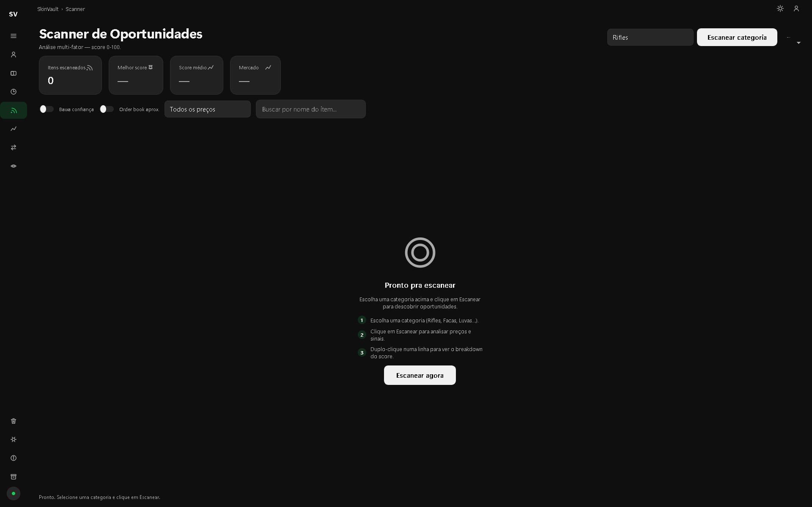
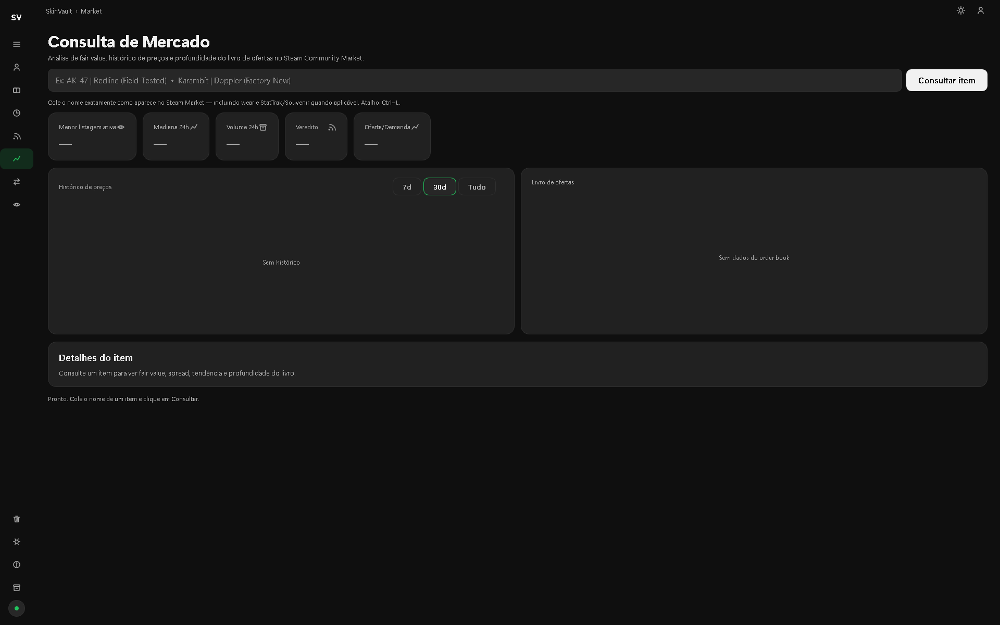
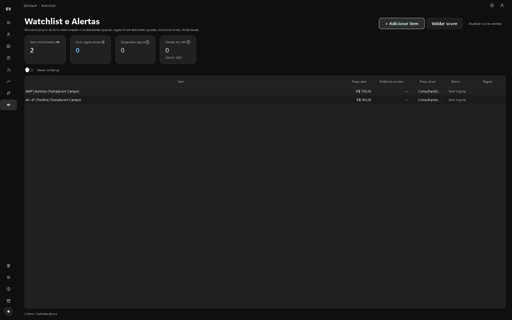
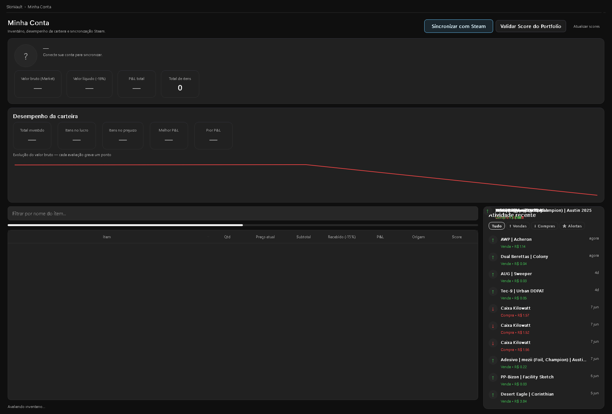

# SkinVault

[](https://github.com/pedronokia/skinvault/actions/workflows/tests.yml)

*Versão em português: [README.pt-BR.md](README.pt-BR.md)*

A desktop and web app for tracking a **CS2** skin inventory and the Steam Community Market:
what your items are worth, what you actually made after fees, and which items show price
signals worth a look. **It runs locally and never asks for a Steam login.** It only reads
public data.

| Opportunity scanner | Market lookup |
|---|---|
|  |  |
| **Watchlist and alerts** | **Portfolio** |
|  |  |

## What it does

- **Portfolio with real profit**: values a public inventory from a SteamID and computes
  **net** profit after the Steam Market's ~15% fee, with the portfolio's value over time.
- **Opportunity scanner**: scores items in whole categories (rifles, knives, gloves...)
  from 0 to 100, with an explainable breakdown: price vs. median, buy/sell spread, order
  book, trend, supply and demand, momentum and liquidity.
- **Cross-market comparison**: puts Steam prices next to real-money marketplaces
  (measured on 732 items: Steam sits ~36% higher at the median).
- **Watchlist with alerts**: price target, percentage drop, volume spike and supply drop
  rules, with automatic re-arming and native Windows notifications.
- **Trade history**: win rate, streaks and period filters, with FIFO matching of buys
  and sells.
- **Game-data watcher**: diffs the game's `items_game.txt` to catch drop-pool rotations
  and new cases, which tend to move the market.
- **Two interfaces over one core**: a PyQt6 desktop app and a Flask + pywebview web UI.

## Research: what actually predicts returns

The scanner's score isn't guesswork. I backtested it against the app's own price-history
cache, measuring each factor's **information coefficient (IC)**: the rank correlation,
across items on the same date, between the factor and each item's later return.
Comparing items on the same date keeps a market-wide rally from looking like a signal.

- **Momentum works backwards.** Items that had just risen went on to do *worse*, at every
  horizon tested from 7 days to a year: this market mean-reverts. Flipping the sign of the
  momentum factors raised the score's 90-day IC for skins from 0.035 to 0.160 (373 price
  series, ~50k samples).
- **Retired cases are the one effect that beats the fee.** Across 41 cases over the same
  three-year window, cases out of the drop pool returned a median +48% a year (+25.8%
  after the 15% fee, 35 of 35 positive), against +18.9% (+1.0% net) for active cases.
  The effect is strongest for recently retired cases and fades as they age (Spearman
  −0.76 between age and return among retired cases).
- **Price is the ceiling.** Cheap items appreciated far more: a median one-year return of
  +73% under R$1 against +8.7% above R$500 (IC −0.26 across all items, −0.30 for cases
  alone).
- **Nothing short-term beats the fee.** The score's top fifth gained +13.6% gross over 90
  days, which is −1.2% after the Steam fee. The score ranks items; it isn't a license to
  flip them.

The backtest also caught two bugs in itself. A "vintage" factor computed a case's age from
today's date instead of the simulated date, leaking the future into the result: its
apparent one-year IC of +0.22 disappeared once fixed. And the fee model treated the fee
as a share of the buy price, which put break-even at 17.65% instead of the correct 15%.

Limits worth knowing: the data only covers items that still trade (survivorship bias),
returns are median to median and ignore the buy/sell spread, and only 5 cases are
currently active. Past results don't guarantee future ones. The full notes, in
Portuguese, are in [`AGENTS.md`](AGENTS.md).

## Engineering decisions

**Steam's rate limit as a design constraint.** Public endpoints block after a few dozen
calls, so caching is a requirement, not an optimization. Each Market page carries up to
~10 variants of the same skin (wear × Normal/StatTrak/Souvenir), and the app stores the
whole batch at once, cutting network cost by up to 10×. A per-endpoint circuit breaker
stops retries while a block is active, since retrying tends to extend it. That breaker is
published on its own as [blockguard](https://github.com/pedronokia/blockguard).

**No login, by choice.** An earlier version synced the account through session cookies.
After reading the Steam Subscriber Agreement, which forbids automating an account, the
feature was **removed**: the app sticks to public, anonymous data, with no ban risk for
the user.

**Facts, not predictions.** The scanner describes what the data shows and explains every
point of the score. It doesn't promise where a price will go.

**Data traps, documented.** For example, the inventory endpoint is served by a CDN that
returns stale snapshots (it needs a cache-buster), and lookups need an exact name match,
or "StatTrak™ X" silently returns the wrong price series. These traps are written up in
[`AGENTS.md`](AGENTS.md).

## Stack

- **Python 3.9+**, **PyQt6** (desktop UI), **Flask + pywebview** (web UI), **httpx** (HTTP)
- Charts drawn by hand with `QPainter` (sparklines, order book, bars, area), with no
  charting library
- Network work runs off the UI thread: `QObject` signals on the desktop, Server-Sent
  Events on the web UI
- Packaged as a Windows `.exe` with PyInstaller; data lives in `%APPDATA%\SkinVault`

## By the numbers

- ~32k lines of application code
- **2,394 automated tests** (pytest), ~28k lines of tests, running in about a minute
- All HTTP goes through a single mock point, so the suite runs without a network

## Running

```bash
python -m venv venv
venv\Scripts\activate          # Windows  (Linux/macOS: source venv/bin/activate)
pip install -r requirements.txt
python -m skinvault --ui        # desktop app
python -m skinvault --web       # web UI
python -m skinvault <SteamID64> # value a public inventory from the terminal
```

Tests:

```bash
pip install pytest
pytest
```

## Layout

```
skinvault/
  steam_api.py     public Steam access (inventory, prices, search, history)
  signals.py       scanner signals and the explainable score
  backtest.py      factor backtests (IC, quintile spread)
  markets.py       prices from other marketplaces, for comparison
  alerts.py        alert rule engine
  portfolio.py     fee-aware portfolio valuation
  ssr_cache.py     price-history cache (24h TTL)
  gamedata.py      game-data change watcher
  ui/              desktop UI, one screen per file plus components and theme
  webapp/          web UI (Flask + pywebview), one route per screen
tests/             pytest suite
```

## Disclaimer

A personal project, not affiliated with Valve. Not investment advice: the numbers
describe the past.
